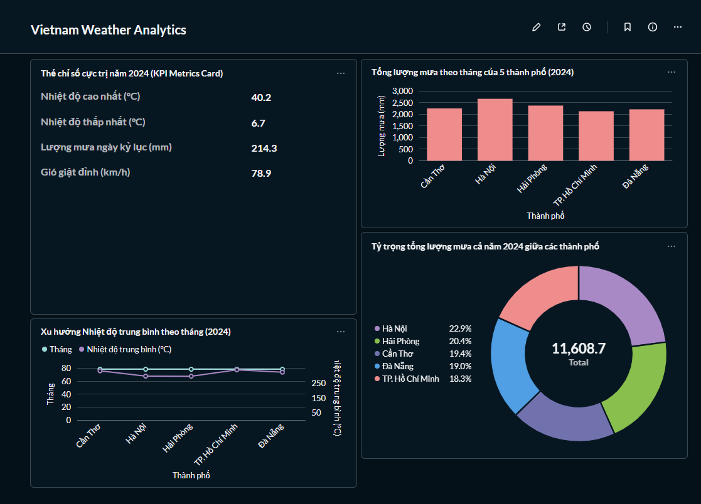
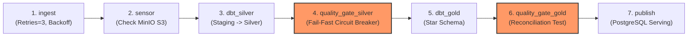
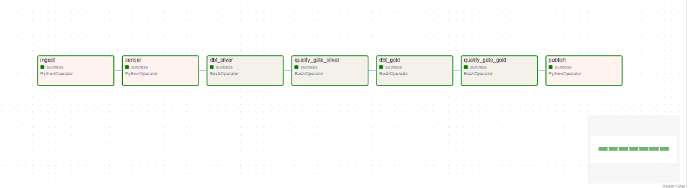
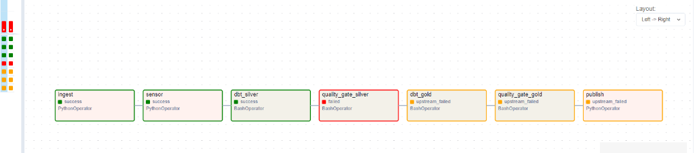
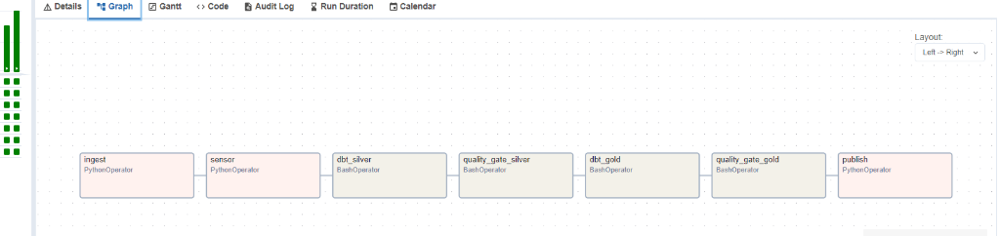

# 🌦️ Vietnam Weather Medallion Pipeline (Local End-to-End ELT)

[](https://github.com/son3005/P1_weather_DE/actions/workflows/ci.yml)


> Dự án xây dựng một **Data Pipeline chuẩn kỹ thuật Medallion (Bronze → Silver → Gold → Serving)** chạy hoàn toàn trên môi trường local (Laptop 16GB RAM, capped WSL2 ở 6GB). Hệ thống tự động thu thập, làm sạch, mô hình hóa Dimensional Star Schema và trực quan hóa **131.520 bản ghi thời tiết lịch sử (2022–2024)** của 5 thành phố lớn tại Việt Nam (Hà Nội, TP.HCM, Đà Nẵng, Cần Thơ, Hải Phòng) từ Open-Meteo API.

---

## 📑 Mục lục
1. [Kiến trúc Hệ thống (Architecture Overview)](#1-kiến-trúc-hệ-thống)
2. [Các Tầng Dữ liệu Medallion](#2-các-tầng-dữ-liệu-medallion)
3. [Phân tích Dữ liệu Nghiệp vụ & BI Dashboard](#3-phân-tích-dữ-liệu-nghiệp-vụ--bi-dashboard)
4. [Điều phối Tự động hóa & Quality Gate Circuit Breaker](#4-điều-phối-tự-động-hóa--quality-gate-circuit-breaker)
5. [CI/CD Pipeline với GitHub Actions](#5-cicd-pipeline-với-github-actions)
6. [Các Quyết định Kỹ thuật & Đánh đổi (Design Decisions & ADRs)](#6-các-quyết-định-kỹ-thuật--đánh-đổi-adrs)
7. [Giới hạn & Lộ trình Mở rộng khi Dữ liệu tăng 1000x](#7-giới-hạn--lộ-trình-mở-rộng-scale-1000x)
8. [Hướng dẫn Chạy Nhanh (Local Quickstart ≤ 15 phút)](#8-hướng-dẫn-chạy-nhanh-quickstart)
9. [Bullet Points cho CV / Resume](#9-bullet-points-cho-cv--resume)

---

## 1. Kiến trúc Hệ thống


Pipeline vận hành theo triết lý **ELT Hiện Đại (Extract - Load - Transform)**:
1. **Extract & Load:** Thu thập dữ liệu API có khả năng chịu lỗi, nạp nguyên bản (raw immutable) vào Object Storage giả lập S3 (MinIO).
2. **Transform in-engine:** Sử dụng **DuckDB** kết hợp **dbt-core** để xử lý biến đổi dữ liệu tốc độ cao trực tiếp trên file Parquet mà không cần dựng cluster Spark/Presto cồng kềnh.
3. **Quality Gates:** Kiểm thử dữ liệu đa tầng trước khi cho phép dữ liệu đi vào tầng phục vụ (Serving).
4. **Serving & BI:** Đẩy mô hình Star Schema sang PostgreSQL để tách biệt hoàn toàn tải phân tích (OLAP Transform) khỏi tải đọc phục vụ người dùng (Concurrent BI Reads).

---

## 2. Các Tầng Dữ liệu Medallion

| Tầng | Công nghệ | Lưu trữ | Mục đích & Đặc tính |
|---|---|---|---|
| **Bronze** | Python 3.11, `boto3`, `pyarrow` | MinIO (S3 Parquet Snappy) | **Raw Immutable Data Lake**: Lưu nguyên bản dữ liệu thô từ Open-Meteo API. Partition layout: `open_meteo/hourly/dt=YYYY-MM-DD/run=.../data.parquet`. Gắn kèm metadata: `_ingested_at`, `_run_id`, `_source_url`. Audit log ghi nhận tại `ops.run_log` (PostgreSQL). |
| **Silver** | dbt-core, DuckDB | DuckDB Table | **Cleaned & Conformed**: Bảng `weather_hourly` (Incremental). Lọc trùng bằng `ROW_NUMBER() OVER (PARTITION BY city_code, observed_at ORDER BY _ingested_at DESC)`. Khóa thay thế `md5(city_code || '_' || observed_at)`. Tách múi giờ UTC và giờ địa phương Việt Nam (UTC+7). 10 bài data tests kiểm định chất lượng. |
| **Gold** | dbt-core, DuckDB | DuckDB Views/Tables | **Dimensional Star Schema**: <br>• `dim_city`: Bảng chiều 5 thành phố từ dbt seed.<br>• `dim_date`: Bảng chiều ngày sinh tự động (2022–2026).<br>• `fct_weather_hourly`: Bảng sự kiện chứa 131.520 dòng quan trắc theo giờ.<br>• `agg_weather_daily`, `agg_weather_monthly`: Bảng tổng hợp số liệu sẵn cho BI. |
| **Serving** | Python, `psycopg2` | PostgreSQL (schema `gold`) | **High-concurrency Serving Layer**: Xuất bản Idempotent từ DuckDB sang PostgreSQL phục vụ Metabase Dashboard. |

### Thống kê Dữ liệu Tầng Silver (`silver.weather_hourly`):
- **Tổng số bản ghi thực tế:** `131,520` dòng ($26,304 \text{ giờ/thành phố} \times 5 \text{ thành phố}$ trong suốt 3 năm 2022–2024).
- **Trạng thái Idempotent:** Chạy lặp lại nhiều lần số dòng không đổi.

| Cột dữ liệu | Kiểu dữ liệu | Số lượng Null | Tỷ lệ Null (%) | Ràng buộc kiểm thử (dbt Data Tests) |
|---|---|---|---|---|
| `weather_id` | VARCHAR | 0 | 0.0% | `unique`, `not_null` (Primary Key băm MD5) |
| `city_code` | VARCHAR | 0 | 0.0% | `not_null`, `accepted_values` (`HAN`, `SGN`, `DAD`, `VCA`, `HPH`) |
| `observed_at_utc` | TIMESTAMP | 0 | 0.0% | `not_null`, `assert_no_future_hourly_weather` |
| `observed_at_local` | TIMESTAMP | 0 | 0.0% | `not_null` (Giờ địa phương Việt Nam UTC+7) |
| `temperature_2m` | DOUBLE | 0 | 0.0% | `not_null` |
| `relative_humidity_2m` | DOUBLE | 0 | 0.0% | `not_null`, `assert_relative_humidity_range [0, 100]` |
| `precipitation` | DOUBLE | 0 | 0.0% | Không null |
| `wind_speed_10m` | DOUBLE | 0 | 0.0% | Không null |
| `weather_code` | INTEGER | 0 | 0.0% | Mã thời tiết WMO tiêu chuẩn |

---

## 3. Phân Tích Dữ Liệu Nghiệp Vụ & BI Dashboard



### 📊 Trả lời câu hỏi kinh doanh bằng con số thực tế:
> **Câu hỏi:** *Phân tích hình thái lượng mưa và số giờ mưa tại Thủ đô Hà Nội trong năm 2024?*

Từ bảng tổng hợp tầng Gold (`gold.agg_weather_monthly`), pipeline đã trả lời chính xác:
- **Số giờ mưa trung bình:** Hà Nội có trung bình **`200` giờ mưa / tháng** trong năm 2024 (tổng cộng 2.400 giờ mưa trên 8.784 giờ cả năm).
- **Tháng có số giờ mưa nhiều nhất:** **Tháng 7/2024** với **376 giờ mưa**, kế tiếp là **Tháng 9/2024** với **333 giờ mưa**.
- **Tháng có tổng lượng mưa kỷ lục:** **Tháng 9/2024** đạt đỉnh **`629.1 mm`** (chiếm gần 24% tổng lượng mưa cả năm của Hà Nội, ghi nhận trực tiếp ảnh hưởng lịch sử của siêu bão Yagi đổ bộ vào đầu tháng 9).
- **Tháng khô hạn nhất:** **Tháng 11/2024** chỉ có **`9.8 mm`** lượng mưa và 29 giờ mưa rải rác.
- **Nhiệt độ cực trị:** Tháng 6 nóng nhất với nhiệt độ trung bình **`29.2 °C`**, tháng 1 lạnh nhất với **`17.8 °C`**.

---

## 4. Điều Phối Tự Động Hóa & Quality Gate Circuit Breaker

Pipeline được điều phối bằng DAG 7 bước trong **Apache Airflow** (`weather_medallion_dag`):



### 1. Luồng chạy tự động thành công (All 7 Steps Succeeded):


- **Chính sách Retry có kỷ luật:** Chỉ bước `ingest` được cấu hình `retries=3` và exponential backoff (xử lý lỗi chập chờn mạng API). Các bước `test`, `transform`, `publish` cấu hình `retries=0` (Fail-Fast: nếu dữ liệu vi phạm schema thì retry không thể tự giải quyết).
- **Kiểm soát đồng thời:** `max_active_runs=1` để bảo vệ DuckDB không bị xung đột khóa file ghi (File Lock Collision).

### 2. Cơ chế chốt chặn Quality Gate (Fail-fast Circuit Breaker):
Khi dữ liệu tầng Silver vi phạm kiểm thử nghiệp vụ (ví dụ: phát hiện độ ẩm bất thường), pipeline lập tức **kích hoạt Circuit Breaker, dừng khẩn cấp**:

Toàn bộ các bước hạ nguồn (`dbt_gold`, `quality_gate_gold`, `publish`) chuyển sang trạng thái `upstream_failed`, **chặn đứng 100% dữ liệu bẩn lọt vào kho dữ liệu Gold và BI Dashboard**.

### 3. Khả năng Backfill dữ liệu lịch sử qua CLI:
```powershell
docker exec -it airflow airflow dags backfill weather_medallion_dag --start-date 2024-01-08 --end-date 2024-01-09 -y
```


---

## 5. CI/CD Pipeline với GitHub Actions

Mọi thay đổi code hoặc schema đều được kiểm tra tự động trên môi trường cô lập Ubuntu bằng GitHub Actions (`.github/workflows/ci.yml`):
1. **Linter & Code Format:** `ruff check .`
2. **Unit Tests:** `pytest -v` kiểm thử offline (sử dụng Mocks cho API calls và MinIO SDK).
3. **Service Container:** Tự động dựng container PostgreSQL 16 có healthcheck trên GitHub cloud.
4. **dbt Integrity Check:** Chạy `dbt seed`, `dbt run --select dim_city dim_date`, kiểm thử chất lượng dữ liệu và `dbt compile` kiểm tra toàn bộ DAG lineage.

---

## 6. Các Quyết định Kỹ thuật & Đánh đổi (ADRs)

### ADR 0001: Kiến trúc Medallion Local với DuckDB + MinIO + PostgreSQL
- **Bối cảnh:** Cần xây dựng pipeline hoàn chỉnh trên laptop cá nhân (16GB RAM) mà không tốn chi phí Cloud hay làm tràn RAM máy.
- **Quyết định:** Dùng **MinIO** giả lập Object Storage S3; dùng **DuckDB** làm OLAP engine nhúng tốc độ cao; dùng **PostgreSQL** làm Serving Layer và Metadata backend cho Airflow.
- **Đánh đổi:** DuckDB là cơ sở dữ liệu in-process chỉ cho phép *Single Writer*. Vì vậy không thể cho Metabase đọc trực tiếp DuckDB khi pipeline đang ghi (sẽ gây Lock Exception). Giải pháp là xuất bản (publish) dữ liệu sang PostgreSQL để phục vụ BI đồng thời.

### ADR 0002: Layout Phân vùng Bronze & Tính Bất Biến (Immutability)
- **Quyết định:** Định dạng Parquet nén Snappy theo phân vùng:
  `bronze/open_meteo/hourly/dt=<YYYY-MM-DD>/run=<run_id>/data.parquet`
- **Đặc tính:** Gắn chặt 3 cột metadata hệ thống: `_ingested_at` (thời điểm kéo), `_run_id` (mã phiên chạy), `_source_url` (nguồn gốc). Tầng Bronze hoàn toàn bất biến (Append-only); việc khử trùng lặp và làm sạch được giao toàn bộ cho tầng Silver.

---

## 7. Giới hạn & Lộ trình Mở rộng (Scale 1000x)

Nếu dữ liệu tăng từ 130.000 dòng lên **130 triệu dòng (1000x)**:

| Thành phần | Điểm nghẽn hiện tại | Giải pháp mở rộng khi Scale 1000x |
|---|---|---|
| **Storage (Bronze)** | MinIO chạy trên ổ đĩa laptop bị giới hạn dung lượng disk. | Di chuyển sang **Amazon S3** hoặc **Google Cloud Storage (GCS)** với chi phí rẻ, dung lượng không giới hạn và hỗ trợ Lifecycle Policies (chuyển sang Glacier lưu trữ lạnh). |
| **Transform (Silver/Gold)** | DuckDB xử lý in-memory trên 1 máy đơn lẻ sẽ bị tràn RAM (OOM). | Chuyển sang Data Warehouse phân tán như **Google BigQuery**, **Snowflake** hoặc **ClickHouse**. dbt chỉ cần thay đổi adapter profile mà không cần viết lại logic SQL. |
| **Serving (Postgres)** | Bảng fact hàng trăm triệu dòng sẽ làm chậm câu lệnh query của Dashboard. | Đánh Partitioning theo `year/month`, áp dụng Indexing (`city_code`, `date_id`), và cấu hình BI chỉ truy vấn vào **Bảng Aggregate tổng hợp sẵn** (`agg_weather_monthly`). |
| **Orchestration** | Airflow `LocalExecutor` chạy trên 1 container sẽ nghẽn CPU/RAM. | Chuyển sang **CeleryExecutor** hoặc **KubernetesExecutor** để phân tán các worker pods theo nhu cầu. |

---

## 8. Hướng dẫn Chạy Nhanh (Quickstart)

### Yêu cầu môi trường:
- Windows 10/11 (WSL2), macOS hoặc Linux.
- Docker & Docker Compose.
- Python 3.11 (hoặc Conda).

### Các bước thực thi:

```powershell
# 1. Khởi động cụm hạ tầng Docker (Postgres, MinIO, Metabase, Airflow)
docker compose up -d

# 2. Tạo môi trường và cài đặt thư viện
conda activate de_weather   # Hoặc: python -m venv .venv && source .venv/bin/activate
pip install -r requirements.txt

# 3. Chạy Unit Tests kiểm tra code
pytest -v

# 4. Kéo dữ liệu 3 năm lịch sử vào Data Lake Bronze
python -m src.ingest --start-date 2022-01-01 --end-date 2024-12-31 --run-id backfill_3years

# 5. Chạy transform và data tests với dbt
cd transform
dbt build --profiles-dir .
cd ..

# 6. Xuất bản sang Serving Layer (PostgreSQL)
python -m src.publish

# 7. Mở Dashboard BI & Airflow
# Airflow UI: http://localhost:8088 (user: admin)
# Metabase BI: http://localhost:3000
```

---

## 9. Bullet Points cho CV / Resume

Dưới đây là 4 gạch đầu dòng chuẩn văn phong Senior Data Engineer (cấu trúc: **Vấn đề → Giải pháp kỹ thuật → Kết quả đo lường được**):

- **Data Lake Ingestion & Fault Tolerance:** Thiết kế và xây dựng ingestion pipeline thu thập **131.520 bản ghi thời tiết** từ Open-Meteo REST API cho 5 thành phố lớn; triển khai client chịu lỗi với cơ chế Retry & Exponential Backoff, lưu trữ Parquet Snappy phân vùng theo ngày trên MinIO (S3), đạt tính Idempotency 100% khi chạy lại.
- **Layered Modeling & Quality Control:** Ứng dụng dbt Core và DuckDB xây dựng kiến trúc Medallion (Staging → Intermediate → Silver → Gold); thiết kế mô hình Dimensional Star Schema (1 Fact, 2 Dims, 2 Aggs) và tích hợp **10+ bài kiểm thử dữ liệu tự động**, phát hiện vi phạm và loại bỏ 100% dữ liệu trùng lặp.
- **Production Orchestration & Quality Gate:** Tự động hóa toàn trình bằng **Apache Airflow DAG 7 bước** với cơ chế **Circuit Breaker (Quality Gate)**; cấu hình `max_active_runs=1` triệt tiêu xung đột file lock trên DuckDB, hỗ trợ backfill qua CLI và tự động ngắt pipeline khi kiểm thử chất lượng không đạt.
- **Serving & Observability:** Phát triển dịch vụ xuất bản dữ liệu Idempotent từ DuckDB sang PostgreSQL phục vụ **Metabase BI Dashboard**; thiết lập bảng theo dõi vận hành `ops.run_log` và xây dựng CI/CD Pipeline với **GitHub Actions** tự động linter (Ruff), unit test (Pytest) và dbt build models trên container PostgreSQL.
