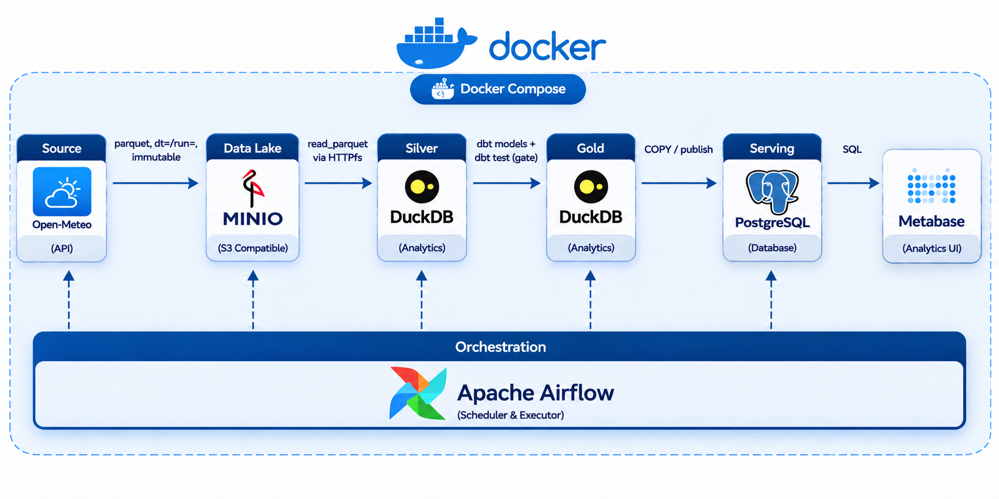

# Pipeline Thời Tiết Việt Nam (Medallion Local Architecture)

Dự án xây dựng một pipeline ELT hoàn chỉnh theo kiến trúc Medallion chạy hoàn toàn trên môi trường local (laptop 16GB RAM), thu thập và phân tích dữ liệu thời tiết 3 năm lịch sử (2022–2024) của 5 thành phố lớn tại Việt Nam (Hà Nội, TP. Hồ Chí Minh, Đà Nẵng, Cần Thơ, Hải Phòng) từ Open-Meteo API.

---

## 1. Sơ đồ Kiến trúc Hệ thống



### Các tầng kiến trúc:
1. **Bronze Layer (Raw Ingestion):**
   - Kéo dữ liệu từ Open-Meteo Archive API bằng Python client có cơ chế Retry & Exponential Backoff.
   - Định dạng lưu trữ: Parquet nén Snappy trên MinIO (S3-compatible object storage).
   - Layout phân vùng: `bronze/open_meteo/hourly/dt=<YYYY-MM-DD>/run=<run_id>/data.parquet`.
   - Tính chất: Bất biến (Immutable), Idempotent (chạy lại cùng `run_id` tự động ghi đè, không sinh trùng lặp).
   - Observability: Tự động ghi nhật ký vận hành từng mẻ chạy vào bảng `ops.run_log` trên PostgreSQL.

2. **Silver Layer (Cleaning, Conforming & Testing):**
   - Sử dụng **dbt Core** kết hợp in-process OLAP engine **DuckDB**.
   - **Staging (`stg_weather_hourly`):** 1:1 với nguồn, chuẩn hóa tên cột và ép kiểu dữ liệu tường minh.
   - **Intermediate (`int_weather_deduped`):** Khử trùng lặp theo `(city_code, observed_at)` bằng `ROW_NUMBER()`, giữ bản ghi có `_ingested_at` mới nhất.
   - **Silver Model (`weather_hourly`):** Mô hình **Incremental**, khóa thay thế `md5(city_code || '_' || observed_at)`, tách múi giờ `observed_at_utc` và `observed_at_local` (Giờ Việt Nam UTC+7).

3. **Gold Layer & Serving (Sắp triển khai):**
   - Mô hình hình sao (Star Schema): `dim_city`, `dim_date`, `fct_weather_hourly` và các bảng aggregate.
   - Publish sang PostgreSQL và trực quan hóa bằng Metabase Dashboard.

4. **Orchestration & CI/CD (Sắp triển khai):**
   - Điều phối bằng Apache Airflow với Quality Gate.
   - CI/CD tự động bằng GitHub Actions.

---

## 2. Thống kê Dữ liệu Tầng Silver (`silver.weather_hourly`)

- **Tổng số bản ghi thực tế:** `131,520` dòng ($26,304 \text{ giờ/thành phố} \times 5 \text{ thành phố}$).
- **Khoảng thời gian bao phủ:** `2022-01-01 00:00:00` đến `2024-12-31 23:00:00`.
- **Trạng thái Idempotent:** Chạy lặp lại nhiều lần số dòng không đổi.

| Cột dữ liệu | Kiểu dữ liệu | Số lượng Null | Tỷ lệ Null (%) | Ràng buộc kiểm thử (dbt Data Tests) |
|---|---|---|---|---|
| `weather_id` | VARCHAR | 0 | 0.0% | `unique`, `not_null` (Primary Key băm MD5) |
| `city_code` | VARCHAR | 0 | 0.0% | `not_null`, `accepted_values` (`HAN`, `SGN`, `DAD`, `VCA`, `HPH`) |
| `observed_at_utc` | TIMESTAMP | 0 | 0.0% | `not_null`, `assert_no_future_hourly_weather` |
| `observed_at_local` | TIMESTAMP | 0 | 0.0% | `not_null` (Giờ địa phương Việt Nam UTC+7) |
| `temperature_2m` | DOUBLE | 0 | 0.0% | `not_null` |
| `relative_humidity_2m` | DOUBLE | 0 | 0.0% | `not_null`, `assert_relative_humidity_range [0, 100]` |
| `precipitation` | DOUBLE | 0 | 0.0% | Không null |
| `wind_speed_10m` | DOUBLE | 0 | 0.0% | Không null |
| `weather_code` | INTEGER | 0 | 0.0% | Mã định danh thời tiết WMO |

---

## 3. Hệ Thống Kiểm Thử Chất Lượng Dữ Liệu (Data Quality)

Dự án áp dụng 10 data tests tự động qua `dbt build`:
- **Generic Tests:** Kiểm tra tính duy nhất (`unique`), không rỗng (`not_null`), và miền giá trị cho phép (`accepted_values`) trên schema.
- **Singular Tests (SQL nghiệp vụ):**
  1. `assert_no_future_hourly_weather.sql`: Đảm bảo không có dòng dữ liệu nào có thời gian quan trắc ở tương lai.
  2. `assert_relative_humidity_range.sql`: Đảm bảo độ ẩm tương đối luôn nằm trong giới hạn vật lý $[0\%, 100\%]$.

---

## 4. Hướng dẫn chạy nhanh trên Local

### Yêu cầu môi trường:
- Windows 10/11 với WSL2 cấu hình tối đa 6GB RAM (`.wslconfig`).
- Docker Desktop.
- Conda (Python 3.11).

### Khởi động hạ tầng:
```powershell
# 1. Khởi động PostgreSQL và MinIO
docker compose up -d

# 2. Kích hoạt môi trường conda
conda activate de_weather
```

### Chạy pipeline Ingestion (Bronze):
```powershell
# Chạy Unit Tests Ingestion
pytest -q

# Kéo dữ liệu 3 năm lịch sử vào MinIO
python -m src.ingest --start-date 2022-01-01 --end-date 2024-12-31 --run-id backfill_3years
```

### Chạy pipeline dbt Transform (Silver):
```powershell
cd transform
dbt debug --profiles-dir .
dbt build --profiles-dir .
```

